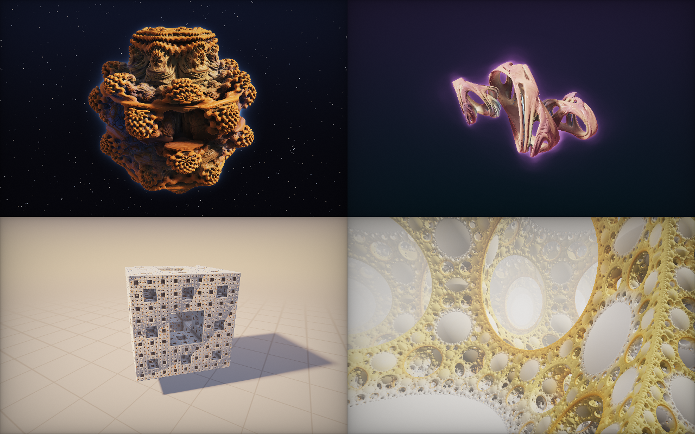

# hier – Fraktale in Echtzeit

Eine einzige HTML-Datei, die vier unendlich detaillierte 3D-Fraktale **live auf der Grafikkarte** berechnet.
Es gibt kein Foto, kein 3D-Modell und keine Bibliothek. Jeder Pixel ist ein Lichtstrahl, der mathematisch durch die Szene verfolgt wird.

**Starten:** `index.html` im Browser öffnen (Doppelklick genügt, ein Server ist nicht nötig).

## Die Szenen

| Taste | Szene | Was passiert |
|---|---|---|
| `1` | **Mandelbulb** | Die 3D-Verwandte der Mandelbrot-Menge: `z ↦ z⁸ + c` in Kugelkoordinaten. Eine wandernde Phase verformt sie langsam. |
| `2` | **Quaternion-Julia** | Eine Julia-Menge in **vier** Dimensionen (Quaternionen). Du siehst einen 3D-Schnitt, dessen Parameter `c` durch den 4D-Raum wandert. |
| `3` | **Menger-Schwamm** | Rekursionstiefe 5, Volumen null, Oberfläche unendlich. Er dreht sich, „atmet“ und wirft echte weiche Schatten auf den Boden. |
| `4` | **Apollonisches Netz** | Kugelinversion `p ↦ s·p/\|p\|²`, unendlich wiederholt. Die Kamera fliegt durch einen Raum, der nie endet. |

## Steuerung

- **Ziehen**: drehen bzw. umschauen
- **Mausrad / zwei Finger**: zoomen
- **`1`–`4` oder `←` `→`**: Szene wechseln
- **Leertaste**: Pause
- **`S`**: Screenshot in voller Auflösung als PNG
- **`H` / Doppelklick**: Oberfläche ausblenden
- **`F`**: Vollbild

Ohne Eingabe läuft nach 30 Sekunden ein Autopilot durch alle Szenen. Direkt verlinken kannst du eine Szene mit `index.html#3`.

## Wie es funktioniert

Auf dem Bildschirm liegt ein einziges Dreieck. Die ganze Arbeit passiert im Fragment-Shader, der für jeden Pixel einzeln läuft:

1. **Sphere Tracing**: Für jedes Fraktal gibt es eine *Distanzschätzung*, also eine Formel, die sagt, wie weit der nächste Punkt der Oberfläche mindestens entfernt ist. Der Strahl springt genau so weit, und das bis zu 220 Mal pro Pixel. Die Abbruchgenauigkeit richtet sich nach der Pixelgröße, deshalb bleibt beim Zoomen immer Detail übrig.
2. **Normalen** über vier zusätzliche Distanz-Auswertungen (Tetraeder-Methode).
3. **Weiche Schatten**: Ein zweiter Strahl läuft zum Licht. Wie knapp er an Geometrie vorbeistreift, bestimmt den Halbschatten.
4. **Ambient Occlusion**: Wie eng ist es rund um den Punkt? Dazu kommt die Verdeckung aus dem *Orbit Trap*.
5. **Orbit-Trap-Färbung**: Die Farbe entsteht daraus, wie nah die Iteration des Fraktals an bestimmte Ebenen und Punkte herankam.
6. **Licht**: Schlüssellicht, Himmelslicht, Gegenlicht, Fresnel-Rand, Schlick-Glanzlicht, Nebel und ein Glühen aus der Schrittzahl.
7. **Nachbearbeitung**: ACES-Tonemapping, Gamma, Vignette und Dithering gegen Farbstufen.

Dazu kommen **adaptive Auflösung** (die Seite misst laufend die Bildrate und passt die Renderauflösung an, damit es auf jeder GPU flüssig bleibt) sowie eine Anzeige, wie viele Millionen Strahlen pro Sekunde gerade berechnet werden.

## Technik

- 1 Datei, gut 1000 Zeilen, **0 Abhängigkeiten**
- WebGL 1 (läuft praktisch überall, auch auf dem Handy)
- Pro Szene wird ein eigener Shader erzeugt, damit keine Verzweigungen im heißen Pfad landen.
- Mit `?quality=1` lässt sich die volle Auflösung erzwingen, ohne automatische Anpassung.
